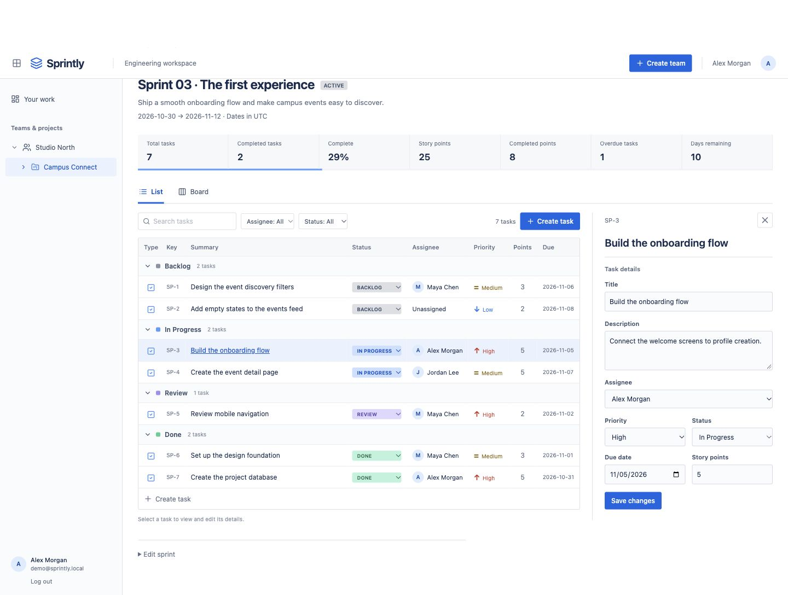
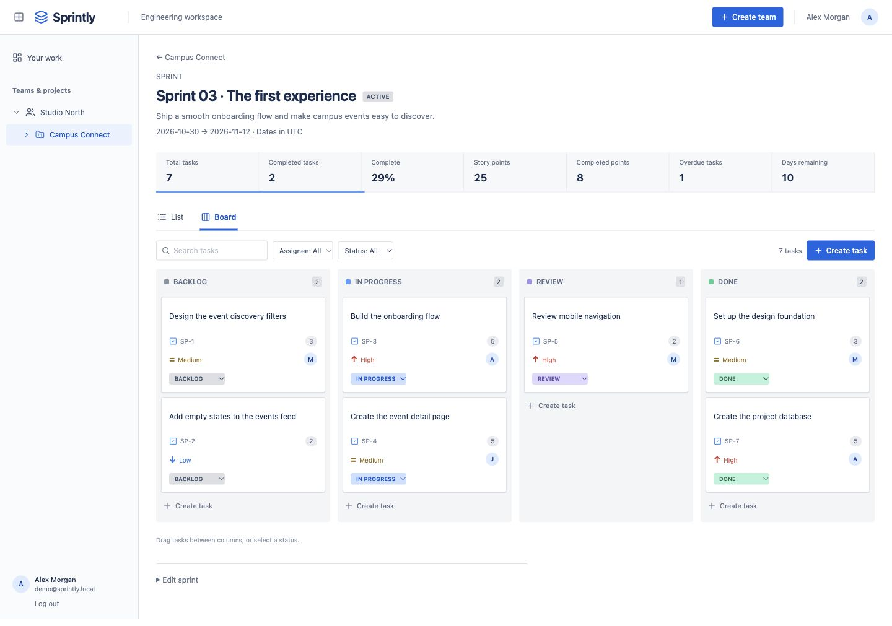
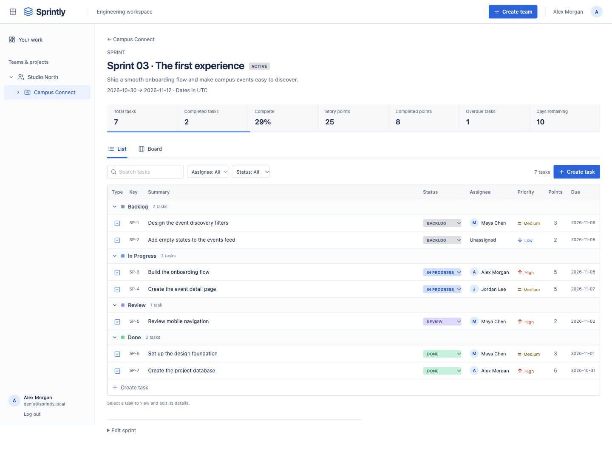

# Sprintly

A lightweight sprint-management workspace for student engineering teams. Built with Next.js App Router, TypeScript, Tailwind CSS, PostgreSQL, Prisma 7, and Auth.js credentials authentication.

## Demo

Sprintly’s sample workspace follows **Studio North**, a three-person engineering team building **Campus Connect**. The sprint includes seven tasks across Backlog, In Progress, Review, and Done, with assignees, priorities, due dates, and story points.

### Plan and edit work in one place

Search and filter the grouped task list, then select a task to open its details without leaving the sprint.



<details>
<summary>See the Kanban board</summary>

Switch to **Board** to move work between columns. Drag a card or use its status menu; the sprint’s completion and story-point metrics update when the change is saved.



</details>

<details>
<summary>See the full task list</summary>

The List view groups work by status and shows ownership, priority, points, and due dates. Search, assignee filters, and status filters work in both views.



</details>

### Try the demo locally

Complete the [local setup](#local-setup), then seed your **development database**:

```sh
DEMO_PASSWORD='choose-a-demo-password' npm run db:seed
npm run dev
```

Open [localhost:3000/login](http://localhost:3000/login) and sign in with:

| Field    | Value                                  |
| -------- | -------------------------------------- |
| Email    | `demo@sprintly.local`                  |
| Password | The `DEMO_PASSWORD` you supplied above |

Then open [the sample sprint](http://localhost:3000/projects/demo-project/sprints/demo-sprint).

**Two-minute walkthrough**

1. Review the sprint goal and metrics: the fresh sample has **7 tasks**, **2 completed**, **29% complete**, and **8 of 25 points completed**.
2. Search for `onboarding`, then select **Build the onboarding flow** to inspect its owner, priority, due date, and points.
3. Clear the search and switch to **Board**. Move that task from **In Progress** to **Review**, then **Done**. The dashboard becomes **3 completed tasks**, **43% complete**, and **13 completed points**.
4. Select **Create task**, enter a title, choose a teammate, and save. Refresh the page to see that the task persists.

The screenshots show the real application with seeded data. This repository does not currently provide a publicly hosted demo. Seeding is optional and idempotent: it adds missing demo records without overwriting existing tasks or passwords. Use a fresh development database to reproduce the exact walkthrough. Never seed a production database.

## Requirements

- Node.js 22.12+ and npm
- PostgreSQL 17 (or Docker Compose for the included development database)

## Local setup

```sh
npm ci
cp .env.example .env
openssl rand -base64 32
```

Set `AUTH_SECRET` in `.env` to the generated value. Set `DATABASE_URL` to your PostgreSQL connection string. The included Compose database matches `.env.example` and binds only to localhost; its example password is for local development.

```sh
docker compose up -d db
npm run db:generate
npm run db:deploy
npm run dev
```

Open http://localhost:3000/login, expand **Create an account**, and register. Create a team, a project, then a sprint. Teammates must register before the owner can add their email. No demo accounts or credentials are created automatically.

## Commands

```sh
npm run lint
npm run typecheck
npm test
npm run build
npm start
```

For schema changes, run `npm run db:migrate -- --name your_change` and commit the generated migration. Apply committed migrations in production with `npm run db:deploy`.

## Deployment

Deploy as a Node.js Next.js app with a managed PostgreSQL database. Set `DATABASE_URL`, a unique random `AUTH_SECRET`, and `AUTH_URL` to the canonical HTTPS app URL. Run `npm ci`, `npm run db:deploy`, and `npm run build`, then `npm start`. Configure the platform's reverse proxy correctly for Auth.js; only enable host trust for infrastructure you control. Do not commit `.env`. Use separate database credentials, backups, and connection limits in production. The application uses the Node runtime and is not intended for static export or Edge-only hosting.

## Features and boundaries

Signup/login; multiple teams; owner-managed membership; project and sprint creation/editing; task creation/editing/assignment; grouped task lists with search and filters, a task detail panel, Kanban drag-and-drop and accessible status menus; sprint metrics. Dates use UTC calendar days. Members can manage work within their own teams. JWT sessions last seven days. Login and registration attempts are throttled per normalized email in PostgreSQL.

Password recovery, email verification, email invitations, deletion, and live multi-user updates are outside this MVP. For public rollout, plan account recovery and additional edge/IP abuse controls. Expired `AuthAttempt` rows can be periodically removed with `DELETE FROM "AuthAttempt" WHERE "expiresAt" < NOW()`.

No AI or GitHub integration exists in the app. GitHub integration, PR tracking, AI summaries, sprint health scoring, and risk detection are future work only.

See [PRD](docs/PRD.md) and [architecture](docs/architecture.md) for scope, authorization rules, data model, folder structure, and future plans.
